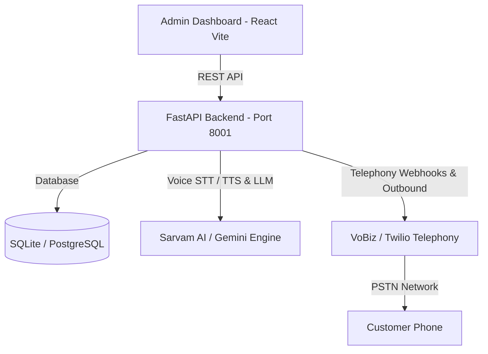

# 📞 AI Calling Agent — Enterprise Telephony & Conversational Voice AI Platform

An enterprise-ready **Autonomous AI Outbound Calling & Lead Qualification Platform** powered by **Sarvam AI**, **FastAPI**, and **React**. Designed for high-volume automated outbound calls, real-time natural language speech interactions, multilingual intent classification, and seamless telephony integrations (VoBiz, Twilio).

---

## 🌟 Key Features

- 🎙️ **Real-time Conversational Voice AI**: Sub-second latency Speech-to-Text (STT) and expressive Text-to-Speech (TTS) using native Sarvam AI models (`saaras:v3` & `bulbul:v2`).
- 🌐 **Multilingual & Indic Language Support**: Fluent interactions in English, Hindi, and regional Indic languages with natural Hinglish code-switching.
- 🧠 **5-Class Customer Intent Classifier**: Proprietary intent engine classifying customer responses into:
  - `Interested` (Lead conversion)
  - `Callback Requested` (Auto-scheduled follow-up)
  - `Not Interested`
  - `Do Not Disturb (DND)`
  - `Voicemail / Answering Machine`
- 📱 **Telephony Integrations**: Plug-and-play outbound telephony via **VoBiz** and **Twilio** with webhook event handling.
- 📊 **Modern Web Dashboard**: High-performance React (Vite + TypeScript + Tailwind) admin UI for campaign management, call logs, analytics, and contact management.
- 💾 **Dual Database Support**: Zero-configuration local SQLite for rapid prototyping and enterprise PostgreSQL for high-scale production.
- 🔄 **Automated Workflows**: Campaign scheduling, disposition tagging, post-call summary generation, and recording storage.

---

## 🏗️ Architecture Overview



---

## 📁 Repository Structure

```text
├── backend/                  # FastAPI Application
│   ├── app/
│   │   ├── api/              # REST Endpoints (calls, campaigns, agents, businesses)
│   │   ├── models/           # SQLAlchemy Database Entities
│   │   ├── schemas/          # Pydantic Schemas & DTOs
│   │   ├── services/         # Business Logic, Telephony & Voice Engines
│   │   └── config.py         # App Configuration & Environment Settings
│   ├── alembic/              # Database Migrations
│   ├── scripts/              # Utility & maintenance scripts
│   ├── requirements.txt      # Python Dependencies
│   └── .env.example          # Backend Environment Template
│
├── frontend_1/               # React + Vite + TypeScript Dashboard
│   ├── src/
│   │   ├── components/       # Reusable UI Components
│   │   ├── features/         # Feature modules (Campaigns, Leads, Analytics)
│   │   └── services/         # Axios API Client
│   ├── package.json          # Node Dependencies
│   └── .env.example          # Frontend Environment Template
│
├── model/                    # Multilingual Intent Classification Engine
│   ├── classifier/           # Engine, Parsers, Lexicons, and Context Analyzers
│   └── tests/                # Test suites & evaluation datasets
│
├── dograh/                   # Optional Voice Workflow Infrastructure & Docker Compose
├── docker-compose.yml        # Multi-container orchestration (Redis, MinIO, DB)
├── start_all.bat             # One-click Windows startup script
└── README.md                 # Project Documentation
```

---

## ⚙️ Prerequisites

Before setting up the project, ensure your environment meets the following requirements:

- **Python**: Version `3.11` or `3.12`
- **Node.js**: Version `18.x` or higher (with `npm`)
- **Git**: Installed and configured
- **Telephony Account**: Active credentials for [VoBiz](https://vobiz.ai) or [Twilio](https://twilio.com)
- **Sarvam AI Account**: API Key from [Sarvam AI](https://www.sarvam.ai)
- **Public URL / Tunnel**: [Ngrok](https://ngrok.com) or a static domain for telephony webhooks

---

## 🐳 Does This Project Need Docker? (Architectural Comparison)

This repository provides **two flexible deployment modes** to match your infrastructure requirements:

| Feature / Mode | ⚡ Mode 1: Native Sarvam AI Mode (Recommended) | 🐳 Mode 2: Docker Infrastructure Mode |
| :--- | :--- | :--- |
| **Docker Required?** | ❌ **No Docker Needed (Zero Docker)** | ✅ **Yes (Requires Docker Desktop)** |
| **Setup Complexity** | Zero configuration — runs in 2 minutes | Multi-container Docker orchestration |
| **Speech Engine** | Native **Sarvam AI** (`saaras:v3` STT & `bulbul:v2` TTS) | Dograh Voice Engine + Pipecat |
| **Database** | Lightweight local SQLite (`calling_agent.db`) | Containerized PostgreSQL (`port 5433`) |
| **Audio Storage** | Local disk storage (`backend/app/recordings/`) | MinIO S3 Object Storage (`ports 9000/9001`) |
| **Background Queue**| Built-in async event loop | Containerized Redis (`port 6379`) |
| **Launch Command** | Double-click `start_all.bat` or run commands | `docker compose up -d` in `dograh/` |

> [!TIP]
> **Which one should you choose?**
> - For fast testing, development, and standard production calling: **Use Mode 1 (Zero Docker)**. It connects directly to Sarvam AI and VoBiz with zero container overhead and lowest latency.
> - For enterprise multi-tenant deployments requiring MinIO S3 audio storage, PostgreSQL clusters, and Redis caching: **Use Mode 2 (Docker Compose)**.

---

## 🎯 Zero-to-Live-Calling Walkthrough (Step-by-Step)

Follow this complete guide to make your first live AI outbound phone call:

### Step 1: Clone the Repository
```bash
git clone https://github.com/Qaanit-Khan/calling-agent-platform.git
cd calling-agent-platform
```

---

### Step 2: Configure Backend Environment
1. Enter the backend directory:
   ```bash
   cd backend
   ```
2. Create your `.env` file from `.env.example`:
   ```bash
   # Windows:
   copy .env.example .env
   # Linux / macOS:
   cp .env.example .env
   ```
3. Open `backend/.env` and fill in your keys:
   ```env
   # Voice Engine & Sarvam AI Credentials
   VOICE_ENGINE=sarvam
   SARVAM_API_KEY=your_actual_sarvam_api_key_here
   SARVAM_DEFAULT_VOICE=shubh

   # VoBiz Telephony Provider Credentials
   VOBIZ_AUTH_ID=your_vobiz_auth_id
   VOBIZ_AUTH_TOKEN=your_vobiz_auth_token
   VOBIZ_FROM_NUMBER=+91XXXXXXXXXX
   ```

---

### Step 3: Install Backend & Frontend Dependencies
1. **Backend**:
   ```bash
   # Windows PowerShell:
   python -m venv .venv
   .\.venv\Scripts\Activate.ps1
   pip install -r requirements.txt
   ```
2. **Frontend**:
   ```bash
   cd ../frontend_1
   copy .env.example .env
   npm install
   ```

---

### Step 4: Start Ngrok Webhook Tunnel
Telecom carriers (VoBiz / Twilio) require a public HTTPS URL to deliver audio stream events and call answers.

Open a new terminal and run:
```bash
ngrok http 8001
```
Copy the forwarding URL (e.g. `https://your-tunnel.ngrok-free.dev`) and set it in `backend/.env`:
```env
BACKEND_PUBLIC_URL=https://your-tunnel.ngrok-free.dev
```

---

### Step 5: Launch All Services
You can start everything in **one click** on Windows:
- Double-click **`start_all.bat`** in the root folder.

Or launch manually:
- **Terminal 1 (Backend)**: `cd backend && uvicorn app.main:app --port 8001 --reload`
- **Terminal 2 (Frontend)**: `cd frontend_1 && npm run dev`

---

### Step 6: Trigger Your Outbound Phone Call
1. Open the Web Dashboard in your browser: [http://localhost:5173](http://localhost:5173).
2. Go to **Agents** and select or customize your voice agent (e.g. Admission Counseling, Broadband Support).
3. Click **Quick Dial** (or go to **Calls** ➡️ **Initiate Call**).
4. Enter the recipient mobile number (e.g., `+9198XXXXXXXX`).
5. Click **Call Now**.
6. The recipient's mobile phone will ring within 2-3 seconds!

---

### 🛑 Intelligent Automatic Call Disconnection (Auto-Hangup)
When the recipient declines or asks to conclude (e.g., saying *"नहीं चाहिए"*, *"कट कर दो"*, *"not interested"*, *"व्यस्त हूँ"*):
1. **Instant Refusal Detection**: The platform identifies negative intent via `is_refusal_or_call_termination`.
2. **Polite Farewell**: The agent immediately says: *"जी ठीक है, समय देने के लिए आपका बहुत धन्यवाद! नमस्कार।"*
3. **PSTN Carrier Disconnect**: The platform automatically fires the VoBiz Carrier Hangup API, immediately terminating the phone call on the customer's device.
4. **Authentic Two-Way Recording**: Both the customer's phone microphone audio and the agent's voice are mixed and saved directly in `backend/app/recordings/` for playback in the dashboard.

---

## 🐳 Optional Mode 2: Launching with Docker Infrastructure

If you wish to use PostgreSQL, Redis, MinIO S3, and Dograh infrastructure:
1. Ensure **Docker Desktop** is running.
2. In your terminal, run:
   ```bash
   cd dograh
   docker compose up -d
   ```
3. This spins up:
   - **PostgreSQL**: `localhost:5433` (`voxora`)
   - **Redis**: `localhost:6379`
   - **MinIO S3 Console**: [http://localhost:9001](http://localhost:9001) (`localhost:9000`)
   - **Dograh Engine**: [http://localhost:8000](http://localhost:8000)
   - **Dograh UI**: [http://localhost:3010](http://localhost:3010)
```bash
ngrok http 8001
```
Copy the generated forwarding URL (e.g., `https://your-domain.ngrok-free.dev`) and set it in your `backend/.env`:
```env
BACKEND_PUBLIC_URL=https://your-domain.ngrok-free.dev
```

---

## 🏃 Running the Application

### Option 1: One-Click Launcher (Windows)
Double-click `start_all.bat` in the root folder. It will automatically:
1. Start the FastAPI backend on port `8001`.
2. Start the Vite React frontend on port `5173`.
3. Launch an ngrok tunnel on port `8001` (if ngrok is installed).

---

### Option 2: Manual Startup

**Terminal 1 — Backend API:**
```bash
cd backend
# Activate venv first
uvicorn app.main:app --host 0.0.0.0 --port 8001 --reload
```

**Terminal 2 — Frontend Dashboard:**
```bash
cd frontend_1
npm run dev
```

---

## 🌐 Default Ports & Access URLs

| Component | URL | Description |
| :--- | :--- | :--- |
| **Frontend Dashboard** | [http://localhost:5173](http://localhost:5173) | Main user interface (Campaigns, Analytics, Calls) |
| **Interactive API Docs** | [http://localhost:8001/docs](http://localhost:8001/docs) | Swagger UI for backend API endpoints |
| **Backend Health Check** | [http://localhost:8001/health](http://localhost:8001/health) | System health status endpoint |

---

## 🔐 Environment Variables Reference

### Backend (`backend/.env`)

| Variable | Required | Default | Description |
| :--- | :---: | :--- | :--- |
| `BACKEND_PORT` | No | `8001` | Port on which FastAPI server runs |
| `BACKEND_PUBLIC_URL` | **Yes** | `http://localhost:8001` | Publicly accessible domain / tunnel for telephony webhooks |
| `DATABASE_URL` | No | `sqlite+aiosqlite:///./calling_agent.db` | Database connection string (SQLite or PostgreSQL) |
| `SARVAM_API_KEY` | **Yes** | — | Sarvam AI API key for Speech-to-Text & Text-to-Speech |
| `SARVAM_DEFAULT_VOICE`| No | `meera` | Default TTS voice (`meera`, `pavithra`, `mahesh`, etc.) |
| `VOBIZ_AUTH_ID` | Optional | — | VoBiz Account Authentication ID |
| `VOBIZ_AUTH_TOKEN` | Optional | — | VoBiz Authentication Token |
| `VOBIZ_FROM_NUMBER` | Optional | — | Verified Caller ID number registered with VoBiz |
| `TWILIO_ACCOUNT_SID`| Optional | — | Twilio Account SID (if using Twilio provider) |
| `TWILIO_AUTH_TOKEN` | Optional | — | Twilio Auth Token (if using Twilio provider) |
| `TWILIO_PHONE_NUMBER`| Optional | — | Twilio phone number |
| `GEMINI_API_KEY` | Optional | — | Google Gemini API key (fallback LLM) |

### Frontend (`frontend_1/.env`)

| Variable | Required | Default | Description |
| :--- | :---: | :--- | :--- |
| `VITE_API_BASE_URL` | **Yes** | `http://localhost:8001` | Base URL of the running FastAPI backend |

---

## 🧪 Testing the Intent Classifier

To test the multilingual interest classification engine independently:

```bash
cd model
pytest tests/ -v
```

---

## 🛡️ Production Deployment Recommendations

1. **Database**: Use managed **PostgreSQL** (AWS RDS, Supabase, or self-hosted) instead of SQLite.
2. **Reverse Proxy & SSL**: Deploy behind **Nginx** or **Traefik** with valid SSL certificates (Let's Encrypt).
3. **Process Manager**: Use **Docker Compose**, **Systemd**, or **PM2 / Gunicorn** with multiple Uvicorn workers for production scaling:
   ```bash
   gunicorn -w 4 -k uvicorn.workers.UvicornWorker app.main:app --bind 0.0.0.0:8001
   ```
4. **Environment Security**: Keep production `.env` files in a secret manager or restricted server environment.

---

## 🤝 Support & Handoff Checklist

Before handing over to the client, verify that:
- [x] Repository contains no `.env` files with active private secrets.
- [x] `.env.example` files are present in both `backend/` and `frontend_1/`.
- [x] Heavy media and database files (`*.wav`, `*.db`, `node_modules`) are excluded via `.gitignore`.
- [x] Client has access to active accounts for Sarvam AI and their selected Telephony Provider (VoBiz/Twilio).
- [x] Client repository is set to **Private** on GitHub.

For questions or customized deployment assistance, please contact the development team.
