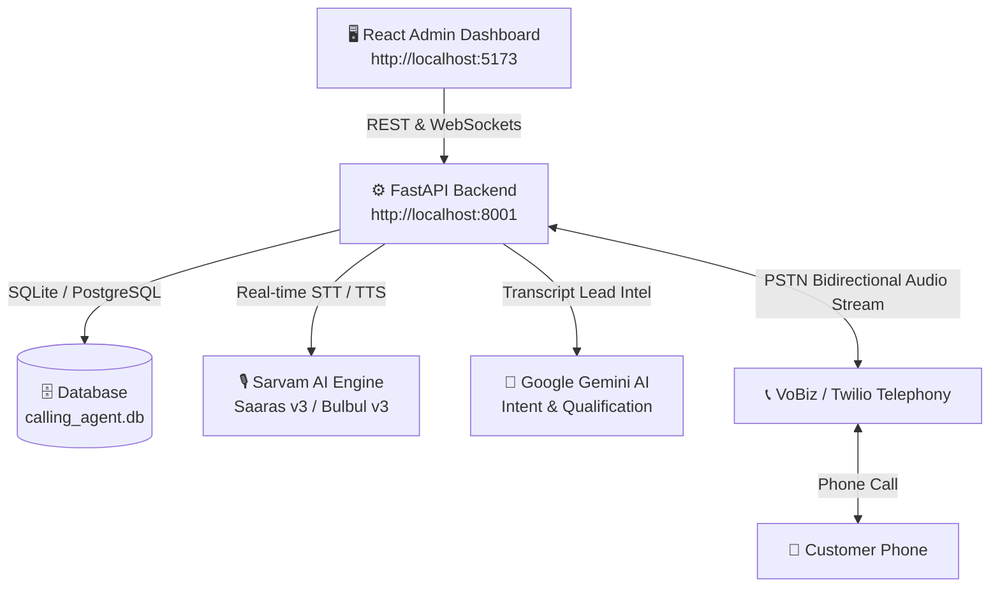

# 📞 ARB SoftTech AI Calling Agent Platform — Client Handover & Setup Guide

Welcome to the **Autonomous AI Outbound Calling & Lead Intelligence Platform**! This repository contains the complete full-stack enterprise calling agent powered by **FastAPI**, **React (Vite + TypeScript)**, **Sarvam AI (TTS/STT)**, **VoBiz / Twilio Telephony**, and **Google Gemini (Transcript Intelligence)**.

This document is the **official, end-to-end setup and handover guide** designed so that any client or developer can set up and run this entire platform on their computer from scratch in under 10 minutes.

---

## 📑 Table of Contents

1. [Architecture & How It Works](#1-architecture--how-it-works)
2. [Software Prerequisites (Install on Client Laptop)](#2-software-prerequisites-install-on-client-laptop)
3. [How to Install & Configure Docker Desktop](#3-how-to-install--configure-docker-desktop)
4. [How to Get Code from GitHub (Client Setup)](#4-how-to-get-code-from-github-client-setup)
5. [Environment Variables Configuration (.env)](#5-environment-variables-configuration-env)
6. [Installing Dependencies (Backend & Frontend)](#6-installing-dependencies-backend--frontend)
7. [Starting the Platform (2 Ways: 1-Click vs Docker)](#7-starting-the-platform-2-ways-1-click-vs-docker)
8. [Verifying Setup & Testing a Live Call](#8-verifying-setup--testing-a-live-call)
9. [Troubleshooting & FAQs](#9-troubleshooting--faqs)

---

## 1. Architecture & How It Works



---

## 2. Software Prerequisites (Install on Client Laptop)

Before setting up the project, install these software tools on your laptop (Windows 10/11 recommended):

| # | Software | Recommended Version | Download Link | Purpose |
| :-: | :--- | :--- | :--- | :--- |
| **1** | **Git** | Latest | [git-scm.com/download/win](https://git-scm.com/download/win) | Code clone & version management |
| **2** | **Python** | `3.11` or `3.12` | [python.org/downloads](https://www.python.org/downloads/) | FastAPI backend execution |
| **3** | **Node.js** | `v20.x LTS` or `v22.x` | [nodejs.org/en/download](https://nodejs.org/) | React Frontend compilation |
| **4** | **Docker Desktop** | Latest | [docker.com/products/docker-desktop](https://www.docker.com/products/docker-desktop/) | Optional container stack (MinIO / Postgres) |
| **5** | **Ngrok** | Latest | [ngrok.com/download](https://ngrok.com/download) | Public URL for live phone webhooks |

> [!IMPORTANT]
> **When installing Python**: Check the box **"Add python.exe to PATH"** on the very first installer screen! Without this, Python commands will not work in the terminal.

---

## 3. How to Install & Configure Docker Desktop

If you plan to run containerized services or production MinIO storage, install Docker Desktop:

### Step 3.1: Download & Install
1. Download installer from [Docker Desktop for Windows](https://desktop.docker.com/win/main/amd64/Docker%20Desktop%20Installer.exe).
2. Run the `.exe` file.
3. Make sure **"Use WSL 2 instead of Hyper-V (recommended)"** is **checked**.
4. Click **OK**, wait for files to extract, and **restart your laptop** when prompted.

### Step 3.2: Enable WSL 2 (If Prompted on First Launch)
If Docker Desktop shows `WSL 2 installation is incomplete`, open **PowerShell as Administrator** and run:
```powershell
wsl --update
wsl --set-default-version 2
```

### Step 3.3: Verify Docker Installation
Open PowerShell or Command Prompt and test:
```powershell
docker --version
docker compose version
```
*(Both should return their respective version numbers without errors).*

---

## 4. How to Get Code from GitHub (Client Setup)

### Step 4.1: Giving Access to the Client (By Repo Owner)
If the repository is **Private**:
1. Open GitHub: `https://github.com/Qaanit-Khan/calling-agent-platform`
2. Go to **Settings** ➔ **Collaborators** ➔ Click **Add people**.
3. Enter client's GitHub username or email and send the invitation.
4. Client accepts the invitation from their email or GitHub notifications.

### Step 4.2: Cloning to Client Computer
Open **PowerShell** or **Git Bash** on the client laptop:
```bash
# Choose folder where you want to keep the project
cd C:\Projects

# Clone the repository
git clone https://github.com/Qaanit-Khan/calling-agent-platform.git

# Enter the project folder
cd calling-agent-platform
```

---

## 5. Environment Variables Configuration (.env)

Sensitive keys (API passwords, carrier secrets) are excluded from Git via `.gitignore`. You must create local `.env` files from templates.

### 5.1: Backend Configuration
```bash
cd backend
copy .env.example .env
```
Open `backend/.env` in VS Code or Notepad and configure:

```ini
# ============================================================
# Server & Public Webhook Settings
# ============================================================
BACKEND_HOST=0.0.0.0
BACKEND_PORT=8001
ENVIRONMENT=development
# Your Ngrok HTTPS URL (e.g. https://your-subdomain.ngrok-free.dev)
BACKEND_PUBLIC_URL=https://your-subdomain.ngrok-free.dev

# ============================================================
# Database Configuration (Zero-config local SQLite default)
# ============================================================
DATABASE_URL=sqlite+aiosqlite:///./calling_agent.db

# ============================================================
# Sarvam AI Voice & Speech Engine (TTS / STT)
# ============================================================
VOICE_ENGINE=sarvam
ACTIVE_MODEL_MODE=sarvam
SARVAM_API_KEY=your_sarvam_api_key_here
SARVAM_DEFAULT_VOICE=shubh
SARVAM_TTS_MODEL=bulbul:v3
SARVAM_STT_MODEL=saaras:v3
SARVAM_LLM_MODEL=sarvam-105b-conversations

# ============================================================
# Google Gemini (Transcript Intelligence & Scoring)
# ============================================================
GEMINI_API_KEY=your_gemini_api_key_here
GEMINI_MODEL=gemini-2.5-flash

# ============================================================
# VoBiz PSTN Telephony Carrier Credentials
# ============================================================
VOBIZ_AUTH_ID=your_vobiz_auth_id_here
VOBIZ_AUTH_TOKEN=your_vobiz_auth_token_here
VOBIZ_FROM_NUMBER=+9180XXXXXXXX
```

### 5.2: Frontend Configuration
```bash
cd ../frontend_1
copy .env.example .env
```
Ensure `frontend_1/.env` contains:
```ini
VITE_API_BASE_URL=http://localhost:8001
```

---

## 6. Installing Dependencies (Backend & Frontend)

### 6.1: Backend Virtual Environment Setup
Open a terminal in `backend/`:
```bash
cd backend

# 1. Create a dedicated Python virtual environment
python -m venv .venv

# 2. Activate the virtual environment
# On Windows PowerShell:
.\.venv\Scripts\Activate.ps1
# (If execution policy error occurs, run: Set-ExecutionPolicy Unrestricted -Scope Process)
# On Windows Command Prompt (CMD):
.\.venv\Scripts\activate.bat

# 3. Install all required dependencies
pip install --upgrade pip
pip install -r requirements.txt
```

### 6.2: Frontend Node Modules Setup
Open another terminal in `frontend_1/`:
```bash
cd frontend_1

# Install Node dependencies
npm install
```

---

## 7. Starting the Platform (2 Ways: 1-Click vs Docker)

You have two easy choices for running the platform:

### ⚡ Method A: 1-Click Native Mode (Recommended / Zero-Docker)
*Fastest setup, zero container overhead, ultra-responsive.*

1. In the project root folder, double-click **`start_all.bat`**.
2. It automatically starts:
   - **FastAPI Backend**: `http://localhost:8001`
   - **React Dashboard**: `http://localhost:5173`
   - **Ngrok Telephony Tunnel**: For VoBiz live telephone streams
3. Open your browser at: **`http://localhost:5173`**!

---

### 🐳 Method B: Docker Stack Mode (Full Production)
*Used when running MinIO S3 audio storage & PostgreSQL.*

1. Ensure **Docker Desktop** is running.
2. In the project root directory, run:
```bash
docker compose up -d --build
```
3. Services:
   - **React Dashboard**: `http://localhost:5174`
   - **FastAPI Backend**: `http://localhost:8001`
   - **API Documentation**: `http://localhost:8001/docs`
   - **Health Endpoint**: `http://localhost:8001/health`

---

## 8. Verifying Setup & Testing a Live Call

Follow this quick 4-step checklist to verify everything is operational:

### Step 8.1: Check Health
Open in browser: `http://localhost:8001/health`  
Status should report `"status": "online"` with healthy database and voice AI engines.

### Step 8.2: Verify Settings in Dashboard
1. Open `http://localhost:5173/settings`.
2. **Sarvam AI Tab**: Click **"Test Connection"** ➔ Shows `CONNECTED` (green).
3. **VoBiz Telephony Tab**: Check that Carrier Auth ID & Token are saved.
4. **Transcript API Tab**: Click **"Test Live Connection"** ➔ Verifies Google Gemini connectivity with response latency in milliseconds.

### Step 8.3: Place an Outbound Test Call
1. Click **AI Agents** in the sidebar.
2. Choose an agent (e.g., *Customer Support Agent*).
3. Click **Quick Call / Dial**, enter your mobile number (`+91XXXXXXXXXX`), and click **Call Now**.
4. Your phone will ring! Answer and talk in Hindi, English, or Hinglish.
5. Hang up and open **Calls History**:
   - Verify the **complete live transcript** of what was spoken.
   - Listen to the **authentic audio recording** via the embedded Audio Player.
   - Check the **Lead Intelligence analysis** (Interested / Callback / Not Interested classification).

---

## 9. Troubleshooting & FAQs

### Q1: Python command not found or 'venv' cannot be created?
**Fix**: Ensure Python is added to your Windows PATH. Open Start Menu, search `Environment Variables`, click `Path`, and verify `C:\Python312` and `C:\Python312\Scripts` are present.

### Q2: What if my Google Gemini API Key limit/quota expires?
**Fix**: You do **not** need to touch the code or restart the server!
1. Go to [aistudio.google.com/app/apikey](https://aistudio.google.com/app/apikey) and generate a new key in 1 click.
2. Open `http://localhost:5173/settings?tab=transcript`.
3. Paste the new key and click **Save & Update Key (Real-Time)**. It updates instantly in runtime memory and `.env`!

### Q3: VoBiz phone call connects, but no audio?
**Fix**: Check that your Ngrok tunnel is running and that `BACKEND_PUBLIC_URL` in `backend/.env` matches your active Ngrok URL (e.g. `https://your-ngrok.ngrok-free.dev`). VoBiz requires a public HTTPS URL to stream telephony audio packets.

### Q4: Port 8001 or 5173 is already in use?
**Fix**: Open Command Prompt and terminate the blocked process:
```bash
netstat -ano | findstr :8001
taskkill /PID <PID_NUMBER> /F
```

---

## 📄 License & Ownership
Created for **ARB SoftTech Calling Agent Platform**. All source code, AI prompts, and models are fully configured for direct enterprise deployment.
